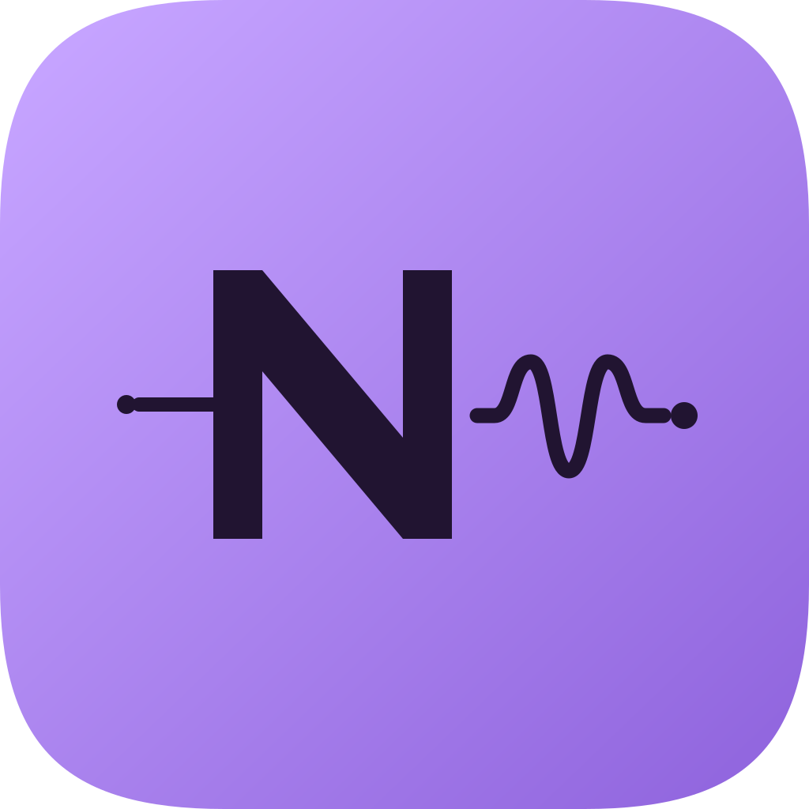

<p align="center">
  
</p>

# NAMplified

**A guitar signal-chain plugin built around Neural Amp Modeler captures.**

NAMplified is a JUCE-based audio effect for shaping a guitar sound from input to output. Build a chain from pedals, NAM captures, cabinet impulse responses, and post-amp effects. The interface keeps the signal path visible while exposing each block's controls when selected.

> **Available now:** [NAMplified 1.1.0 for macOS](https://github.com/sedosa-guitar/namplified/releases/tag/v1.1.0), including Standalone, Audio Unit and VST3. Requires Apple Silicon and macOS 14.4 or later. Preset Builder is in beta.

See [CHANGELOG.md](CHANGELOG.md) for a summary of the project history.

## Support NAMplified

NAMplified is a free hobby project. If you’d like to help cover development costs, you can [leave a tip on Ko-fi](https://ko-fi.com/sedosa).

## Key features

- **Pitch transpose.** Shift the guitar by up to 12 semitones in either direction with Rubber Band, then blend the shifted and original signals. Pitch processing adds latency when active.
- **A complete guitar rig around NAM captures.** See the signal flow from input to output and edit each block in place. Move pre-amp and post-amp effects within their sections.
- **Dual amps and flexible cabinet routing.** Run two NAM captures in series or blend them in parallel, with an optional frequency split. Pair each amp with its own IR or route the blend through a shared IR. Shape each cabinet independently.
- **Four-track looper.** Record and layer guitar parts with an optional click and individual track controls.
- **Rig Shootout.** Compare two amp and cabinet setups at matched levels using the same dry guitar loop.
- **A dedicated NAM pedal slot.** Use a captured pedal before the amps or choose the built-in Clean Boost or 808 Drive.
- **Local AI Preset Builder with audio A/B.** Describe a sound, then record or import a dry DI to compare the original chain with two generated variants at matched levels. After setup, generation runs on your Mac. If a suitable capture is missing, the builder can suggest a TONE3000 search.
- **A reusable capture and IR library.** Presets share files, Prev/Next steps through capture families, and the integrated TONE3000 browser loads individual captures you choose.
- **Standalone and DAW workflows.** Use the same rig in the macOS standalone app, AU or VST3, with MIDI CC Learn for hands-on control.

## Features

### Build a signal chain

- **Input section:** input trim, pitch transpose, and pitch blend.
- **Pre-amp blocks:** Noise Gate, 1176-style compressor, Boost, and five-band Pre EQ. Reorder these blocks within the section and enable or disable them individually.
- **Two NAM slots:** load a Neural Amp Modeler (NAM) capture into either slot, adjust its input/output levels, and shape it with a Bass/Mid/Treble EQ placed before or after the capture.
- **Two cabinet IR slots:** load cabinet impulse responses, shape each IR with its own three-band EQ, and blend the two cabinet paths.
- **Post-amp blocks:** Delay, Reverb, Chorus, and nine-band Post EQ. Reorder and enable them individually.
- **Output section:** output trim and a signal meter. Input and output meters show signal level and briefly indicate clipping.
- **Presets:** save, recall, and delete user presets; reset the chain to its default setup. Presets reference the shared `Presets/Library` folder. Back up the entire `Presets` folder to keep the files together. Unsaved parameter and capture changes are indicated in the interface.
- **MIDI CC Learn:** assign incoming MIDI CC messages to parameters and switches by selecting MIDI Learn, clicking a control, then moving a controller. Mappings are shared across presets and saved in the user's application data folder.

The default chain starts with Input → Noise Gate → Amp 1 → IR 1 → Reverb → Output. Optional blocks can be enabled as needed; the chain editor presents the available stages and lets you reorder movable blocks inside their sections.

### NAM routing

Each of the two NAM slots loads a compatible `.nam` capture. Capture files can be switched with the previous/next controls when they share a folder. Preset saving imports capture families and IRs into the shared library and reuses them for subsequent saves. Older presets can still load from their original `_Assets` folders and use the shared library when resaved.

The amp slots can run **in series** or **in parallel**. In series, the output of one active amp feeds the next. In parallel, both amp paths run side by side and can be blended. Cabinet routing offers two choices for parallel amps:

1. **Paired IRs:** Amp 1 feeds IR 1 and Amp 2 feeds IR 2; the cabinet paths can be blended.
2. **Shared IR 1:** the amp outputs are blended first, then processed through IR 1.

Both NAM slots can run in series or parallel without changing the overall routing layout.

### Cabinet IRs

- Load up to two cabinet impulse responses in WAV, AIFF, FLAC, or OGG format.
- Blend the two IR paths in parallel; the IRs are summed from their input rather than cascaded one after another.
- Use **IR Shape EQ** on each cabinet slot for low, mid, and high tone shaping.
- In Shared IR 1 routing, both amp paths feed the shared first IR.

### Effects and tone shaping

- **Boost:** choose the built-in Clean Boost or 808 Drive, or switch the same block to a NAM capture. The NAM option can load individual captures and step through captures in the same folder.
- **Compressor:** an 1176-inspired FET-style compressor with selectable ratios, including All Buttons In, plus attack, release, blend, output, tone, and EQ controls.
- **Pre EQ:** five adjustable bands before the amp section.
- **Post EQ:** nine adjustable bands after the effects section, with an expanded editor view.
- **Delay:** Digital or Analog character, Mono/Stereo/Ping Pong routing, plus time, feedback, mix, tone, ducking, and wet-path high-pass / low-pass filters. Analog mode uses the 16,384-stage bucket-brigade DSP from ChowMatrix for bandwidth-limited repeats.
- **Reverb:** Room uses Freeverb3 from Dragonfly Room for early reflections and the reverb tail. Plate uses Airwindows kPlate140, and Cloud uses Airwindows Galactic2. Size/decay, damping, pre-delay, width, wet-path high-pass / low-pass, and mix remain adjustable. Room reverb is enabled by default at a subtle mix. Select **IR** and load a mono or stereo WAV impulse response for convolution reverb. IR mode uses pre-delay, wet filters and mix, and plays dry until an IR is loaded. IRs are limited to the first 10 seconds.
- **Chorus:** Uses Airwindows TakeCare, a stereo chorus ensemble. Adjust Rate, Depth, and Mix, with Random, Regen, Derez, Buffer, and Output grouped under Advanced.

### Four-track looper

Record loops up to 60 seconds with a visual count-in, selectable time signatures, and an optional metronome. Recordings align to bar boundaries. Set the level, mute, or clear each track independently.

### Rig Shootout

Open **Amp & IR Comparison** from the two-panel icon next to Preset Builder. Record a dry guitar take or load a DI WAV. Each rig can use up to two NAM captures and two cabinet IRs, with series or parallel routing. Use the arrows to step through captures in the same folder.

Switch between **Listen A** and **Listen B** to hear the same loop at matched levels. **Compare volume** controls playback for both rigs. Choose **Apply A** or **Apply B** to bring that amp and cab setup into the current chain.

### Create NAM Capture (V2, Apple Silicon standalone)

Use the waveform-plus icon between **Amp & IR Comparison** and **Preset Builder** to create a playable `.nam` model of your amp or pedal.

1. Set your interface to **48 kHz**. Connect an interface output through a reamp box to your amp or pedal input, then connect the gear's output or a microphone to an interface input. Never connect an amp's speaker output directly to the interface.
2. Select the connected **Interface output** and **Interface input**, then click **Start capture**. NAMplified downloads the official test WAV on first use and plays it through your gear while recording the return. The signal chain stays muted while the dialog is open.
3. Click **Train model** and choose a destination folder. When training finishes, **Use in Amp A** loads the resulting `Capture.nam`. Disconnect the capture cables before closing the dialog to resume live monitoring.

Click **Set up trainer** once to download the trainer and PyTorch. The standalone app includes Python, and training runs locally after setup. [Official NAM Trainer Guide](https://neural-amp-modeler.readthedocs.io/en/latest/tutorials/gui.html)

### Preset Builder (Beta, macOS)

Open **Build Preset**, describe the sound, and select **Build**. The first build asks before downloading llama.cpp and the Qwen model (about 2.5 GB). NAMplified verifies each download with SHA-256 and reuses the local files for later builds. **Open Model Folder** reveals them in Finder. **Close** stops the local server.

Use **Choose Library** to select a folder containing your NAM captures and IRs. The builder includes its subfolders and remembers your selection. Saving a NAMplified preset also imports its referenced assets into the library. When the builder suggests a capture to look for, **Search on TONE3000** opens the website with that search term.

For audio comparison, load a dry DI WAV (up to 12 seconds are used) or record up to 20 seconds. Use a mono WAV or put the DI in the left channel of a stereo WAV. After building, listen to **Original**, **A** and **B** at matched levels, then choose **Use A** or **Use B**. A build without DI applies the generated chain directly when a usable local capture is available. Use **Save** in the main window to keep the result.

## Signal flow

```text
Input trim → Pre-amp blocks → Amp 1 / Amp 2 → Cabinet IR 1 / IR 2
           → Delay / Reverb / Chorus / Post EQ → Output trim
```

The exact route depends on which blocks are enabled and whether the amp section is set to Series or Parallel Blend. In parallel mode, the amp and cabinet paths are drawn separately in the chain view.

## MIDI control

NAMplified accepts MIDI input. In the standalone app, choose a MIDI input device in **Options → Audio/MIDI Settings**; in a DAW, enable the track's MIDI input for NAMplified. Choose **MIDI Learn** from the main menu, click a slider, knob, selector, or block enable switch, and send a MIDI CC from the controller. The assigned CC controls that parameter across presets. MIDI assignments are stored separately from presets on the current computer.

## NAM compatibility

NAMplified uses [NeuralAmpModelerCore](https://github.com/sdatkinson/NeuralAmpModelerCore) 0.5.4. The current build supports NAM model file versions 0.5 through 0.7 and expects mono-in/mono-out captures. Stereo processing is handled by running paired mono instances where applicable. NAM A2 architecture parsing is included; individual models still need to use an architecture supported by the bundled NAM Core version.

### TONE3000 model browser

NAM blocks include **Browse TONE3000**. The user signs in to their own TONE3000 account in the browser, chooses a NAM tone, then chooses one compatible A1 or A2 capture. NAMplified downloads only that selected `.nam` model into the current computer's application data folder and loads it into the selected NAM slot. The OAuth token is kept in memory for this operation; NAMplified does not upload captures. When a user saves a preset, the preset manager imports referenced NAM captures and IR files into the shared library. A sidecar metadata file and the downloaded filename retain the tone, model, creator, and license details.

This integration uses the TONE3000 **publishable key** as its public OAuth client ID. It does not contain a TONE3000 secret key. Developers building with their own OAuth client ID must register `http://127.0.0.1:49157/tone3000/callback` as an allowed redirect URI for that client. The browser flow requires network access and a free TONE3000 account. The integration downloads individual model files; it does not use or recreate TONE3000's partner-only whole-tone ZIP download.

The Browse button uses the official TONE3000 logo asset, kept unmodified in `Assets/Branding/TONE3000Logo.svg`, following TONE3000's [logo usage guidance](https://www.tone3000.com/api). This README links to the [TONE3000 website](https://www.tone3000.com).

TONE3000 Support has confirmed that the integration may retrieve a selected tone's details, list its compatible captures and download the capture chosen by the user. Catalog downloads require the user's authentication and selection. Creator names, metadata and license information must be preserved, and the integration must follow TONE3000's branding and design guidance. NAMplified is an independent project. [TONE3000 API terms](https://www.tone3000.com/api/terms) · [API documentation](https://www.tone3000.com/api)

## Cabinet sources and routing

See the current screenshots in the [NAMplified Web project](https://github.com/sedosa-guitar/namplified-web).

### Cabinet IR controls

**Impulse Response** loads a cabinet impulse response and offers independent low, mid, and high EQ.

### Amp and cabinet routing

**Series** feeds one active amp into the next, then blends the two cabinet IRs.

**Parallel with paired IRs** sends each amp to its own cabinet IR.

**Parallel with a shared IR** blends the two amp paths before a single cabinet IR.

With two cabinets active in Series, **CAB 1 / CAB 2** controls their mix. Double-click the cab or amp blend to reset two active paths to 50/50.

## Build from source (macOS)

### Requirements

- macOS and Xcode Command Line Tools (or Xcode), including the macOS SDK
- CMake 3.22 or newer
- Git and network access on the first configure, unless dependencies are supplied locally

### Configure and build

From the repository root:

```sh
cmake -S . -B build -DCMAKE_BUILD_TYPE=Release
cmake --build build --config Release
```

The first configure fetches JUCE 9.0.5, NeuralAmpModelerCore 0.5.4, `chowdsp_wdf` 1.0.0, and Rubber Band Library 4.0.0. To use an existing JUCE checkout, pass its path with `-DJUCE_SOURCE_DIR=/path/to/JUCE`.

Build products are placed under `build`. The CMake project currently generates **AU**, **VST3**, and **Standalone** macOS targets. The standalone application can be opened from the generated `NAMplified_artefacts` directory; plugin bundles are generated alongside it.

### Regression tests

On macOS, build and run the test suites with CMake and CTest:

```sh
cmake -S . -B build -DNAMPLIFIED_BUILD_TESTS=ON
cmake --build build --target NAMplifiedTests
ctest --test-dir build --output-on-failure
```

The suites check looper count-in, bar boundaries and multitrack playback,
preset name validation and save/load, parallel amp and cabinet mixing, Standard
and Ping Pong delay, both chorus modes, Rig Shootout playback and rig application,
and pitch shifting at several intervals. The processor tests use a separate home directory inside the build folder.

## Installation

Download the [NAMplified 1.1.0 macOS ZIP](https://github.com/sedosa-guitar/namplified/releases/download/v1.1.0/NAMplified-1.1.0-macOS-arm64.zip) and its [SHA-256 checksum file](https://github.com/sedosa-guitar/namplified/releases/download/v1.1.0/NAMplified-1.1.0-macOS-arm64.zip.sha256). Requires an Apple Silicon Mac running macOS 14.4 or later.

Extract the ZIP in Finder and follow the included **Installation.html**, or read the [installation guide](docs/INSTALL-macOS.html). The build is ad-hoc signed. macOS may require first-launch approval through **System Settings → Privacy & Security → Open Anyway**.

To verify the download, run this command from the folder containing both files:

```sh
/usr/bin/shasum -a 256 -c NAMplified-1.1.0-macOS-arm64.zip.sha256
```

A matching ZIP reports **OK**. The matching source archive and license notices are included in **Licenses-and-Source** inside the download. The [v1.1.0 tag](https://github.com/sedosa-guitar/namplified/tree/v1.1.0) points to the exact build source.

Standalone, AU, and VST3 include the Sedosa presets and their factory NAM captures. On startup, NAMplified restores missing factory captures and missing presets under **Artist → Sedosa**, preserving existing files with the same names.

## Third-party software and licenses

Thanks to the developers whose work helps shape NAMplified’s sound.

- [Airwindows](https://github.com/airwindows/airwindows) by Chris Johnson provides **TakeCare** chorus, **kPlate140** plate reverb, and **Galactic2** cloud reverb.
- [Dragonfly Reverb](https://github.com/michaelwillis/dragonfly-reverb) and Teru Kamogashira’s Freeverb3 provide the room reverb.
- Jatin Chowdhury’s [ChowMatrix](https://github.com/Chowdhury-DSP/ChowMatrix) and [chowdsp_wdf](https://github.com/Chowdhury-DSP/chowdsp_wdf) underpin the analog delay and boost modelling.
- Steven Atkinson’s [NeuralAmpModelerCore](https://github.com/sdatkinson/NeuralAmpModelerCore) runs the NAM captures. [JUCE](https://github.com/juce-framework/JUCE) provides the app and plug-in framework.

See [Third-Party Notices](THIRD_PARTY_NOTICES.md) for exact source revisions and license terms, including the fonts and the optional Preset Builder’s llama.cpp runtime and Qwen model.

**NAMplified's own code is licensed under the GNU Affero General Public License, version 3 only (AGPL-3.0-only).** See [`LICENSE`](LICENSE). Third-party components retain their own licenses and notices listed above and in [`THIRD_PARTY_NOTICES.md`](THIRD_PARTY_NOTICES.md).

Copyright (C) 2026 Ronny Wels (sedosa).

NAMplified is free to download and use, with no paid features. AGPL-3.0-only still permits compliant third-party forks to charge for copies.

When publishing plugin binaries or installers, provide access to the corresponding source code for that exact release and retain the required third-party license notices.

## Known limitations

- Current CMake targets are for macOS only.
- NAM captures must be mono-in/mono-out and compatible with the bundled NAM Core version.
