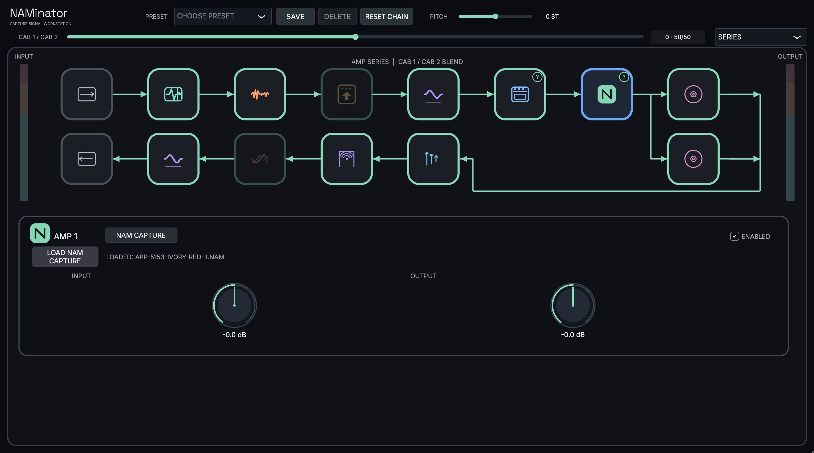
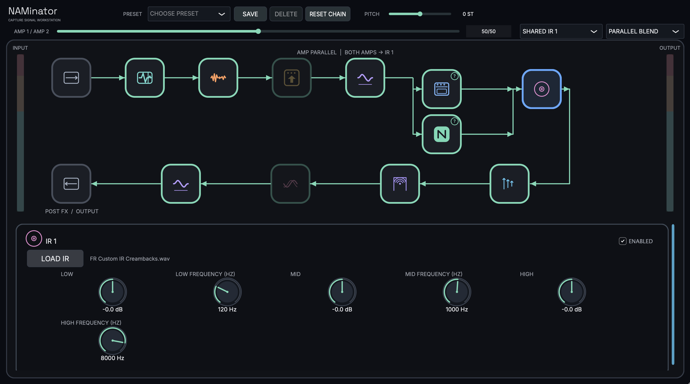
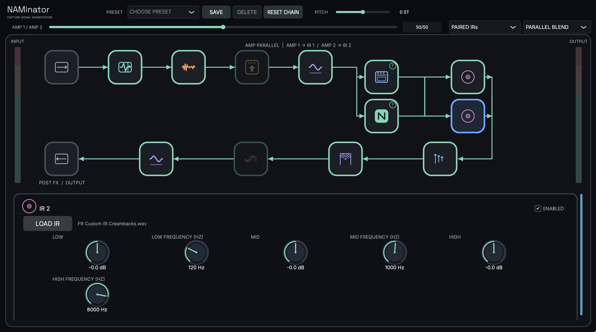
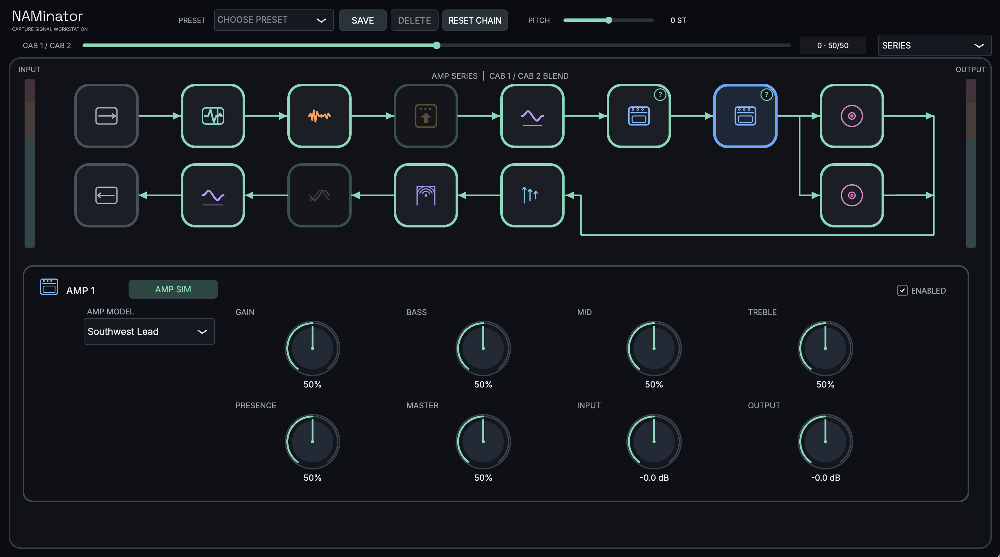
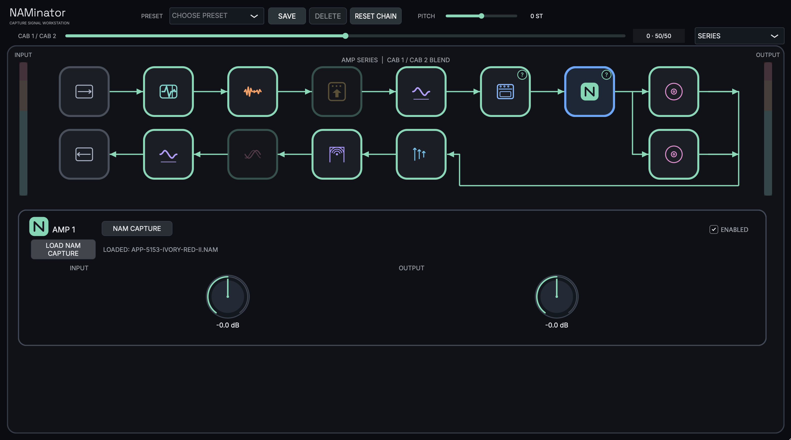

# NAMinator

**A guitar signal-chain plugin built around Neural Amp Modeler captures and amp simulations.**

NAMinator is a JUCE-based audio effect for shaping a guitar sound from input to output. Build a chain from pedals, NAM captures or built-in amp models, cabinet impulse responses, and post-amp effects. The interface keeps the signal path visible while exposing each block's controls when selected.

> **Project status:** In active development. The plugin currently builds macOS Audio Unit, VST3, and standalone targets. Distribution packages and installation instructions are not ready yet.

## Features

### Build a signal chain

- **Input section:** input trim and global pitch shift from −24 to +24 semitones.
- **Pre-amp blocks:** Noise Gate, 1176-style compressor, Boost, and five-band Pre EQ. Reorder these blocks within the section and enable or disable them individually.
- **Two amp slots:** load a Neural Amp Modeler (NAM) capture into either slot, or switch that slot to one of the built-in amp simulations.
- **Two cabinet IR slots:** load cabinet impulse responses, shape each IR with its own three-band EQ, and blend the two cabinet paths.
- **Post-amp blocks:** Delay, Reverb, Chorus, and nine-band Post EQ. Reorder and enable them individually.
- **Output section:** output trim and a signal meter. Input and output meters show signal level and briefly indicate clipping.
- **Presets:** save, recall, and delete user presets; reset the chain to its default setup. Unsaved parameter changes are indicated in the interface.

The default chain starts with Input → Noise Gate → Amp 1 → IR 1 → Reverb → Output. Optional blocks can be enabled as needed; the chain editor presents the available stages and lets you reorder movable blocks inside their sections.

### Amp sources and routing

Each of the two amp slots can use either:

- **NAM Capture:** load a compatible `.nam` model.
- **Amp Sim:** choose from twelve built-in amp models, with controls such as Gain, Volume, Bass, Mid, Treble, Presence, and model-specific parameters.

The amp slots can run **in series** or **in parallel**. In series, the output of one active amp feeds the next. In parallel, both amp paths run side by side and can be blended. Cabinet routing offers two choices for parallel amps:

1. **Paired IRs:** Amp 1 feeds IR 1 and Amp 2 feeds IR 2; the cabinet paths can be blended.
2. **Shared IR 1:** the amp outputs are blended first, then processed through IR 1.

NAM captures and amp simulations use the same amp slots, so a slot can be switched between sources without changing the overall routing layout.

### Cabinet IRs

- Load up to two cabinet impulse responses in WAV, AIFF, FLAC, or OGG format.
- Blend the two IR paths in parallel; the IRs are summed from their input rather than cascaded one after another.
- Use **IR Shape EQ** on each cabinet slot for low, mid, and high tone shaping.
- In Shared IR 1 routing, both amp paths feed the shared first IR.

### Effects and tone shaping

- **Boost:** choose Clean Boost or 808 Drive. Clean Boost provides post volume and tone controls; 808 Drive provides drive, tone, and level controls.
- **Compressor:** an 1176-inspired FET-style compressor with selectable ratios, including All Buttons In, plus attack, release, blend, output, tone, and EQ controls.
- **Pre EQ:** five adjustable bands before the amp section.
- **Post EQ:** nine adjustable bands after the effects section, with an expanded editor view.
- **Delay:** Digital or Analog character, Mono/Stereo/Ping Pong routing, plus time, feedback, mix, tone, and ducking controls.
- **Reverb:** Room, Plate, and Cloud modes with size/decay, damping, pre-delay, width, and mix controls. Room reverb is enabled by default at a subtle mix.
- **Chorus:** rate, depth, and mix controls.
- **Pitch:** global pitch shifting before the input signal enters the chain, with a range of −24 to +24 semitones.

## Signal flow

```text
Input trim → Pitch → Pre-amp blocks → Amp 1 / Amp 2 → Cabinet IR 1 / IR 2
           → Delay / Reverb / Chorus / Post EQ → Output trim
```

The exact route depends on which blocks are enabled and whether the amp section is set to Series or Parallel Blend. In parallel mode, the amp and cabinet paths are drawn separately in the chain view.

## NAM compatibility

NAMinator uses [NeuralAmpModelerCore](https://github.com/sdatkinson/NeuralAmpModelerCore) 0.5.4. The current build supports NAM model file versions 0.5 through 0.7 and expects mono-in/mono-out captures. Stereo processing is handled by running paired mono instances where applicable. NAM A2 architecture parsing is included; individual models still need to use an architecture supported by the bundled NAM Core version.

## Screenshots

### Series mode



### Parallel amps with a shared IR



### Parallel amps with paired IRs



### Built-in amp simulation



### NAM capture



<!-- TODO: Add screenshots of the expanded Post EQ and Delay/Reverb controls when available. -->

## Build from source (macOS)

### Requirements

- macOS and Xcode Command Line Tools (or Xcode), including the macOS SDK
- CMake 3.22 or newer
- Git and network access on the first configure, unless dependencies are supplied locally

### Configure and build

From the repository root:

```sh
cmake -S . -B build -DCMAKE_BUILD_TYPE=Release
cmake --build build --config Release
```

The first configure fetches JUCE 9.0.5, NeuralAmpModelerCore 0.5.4, and `chowdsp_wdf` 1.0.0. To use an existing JUCE checkout, pass its path with `-DJUCE_SOURCE_DIR=/path/to/JUCE`.

Build products are placed under `build`. The CMake project currently generates **AU**, **VST3**, and **Standalone** macOS targets. The standalone application can be opened from the generated `TheLead_artefacts` directory; plugin bundles are generated alongside it.

## Installation

> **Placeholder:** Release builds and verified installation steps are not published yet. These sections will be completed when distributable packages are available.

### macOS standalone

<!-- TODO: Add download link, supported macOS versions, installation steps, and first-launch audio setup. -->

### Audio Unit (AU)

<!-- TODO: Add package location, installation steps, host rescanning instructions, and signing/notarization details. -->

### VST3

<!-- TODO: Add package location, installation steps, host rescanning instructions, and signing/notarization details. -->

### Windows / Linux

<!-- TODO: State platform support only after those targets are built and verified. -->

## Third-party software and licenses

Third-party attributions and license texts are collected in [`THIRD_PARTY_NOTICES.md`](THIRD_PARTY_NOTICES.md). The built-in amp simulation DSP is derived from 0xFX under the MIT License. The Boost circuit uses `chowdsp_wdf` under the BSD 3-Clause License. NAM Core and JUCE are fetched as build dependencies; review their upstream license terms when building or distributing NAMinator.

**NAMinator's own distribution license:** <!-- TODO: Choose and add the project's license before publishing source or binaries. -->

## Known limitations

- Current CMake targets are for macOS only.
- NAM captures must be mono-in/mono-out and compatible with the bundled NAM Core version.
- Amp simulations are circuit-inspired DSP models, not official recreations endorsed by amplifier manufacturers.
- Installation packages, signing/notarization guidance, and a project-level license are still to be added.

## Contributing

Contribution and issue-reporting guidance will be added before the public GitHub release.

<!-- TODO: Add contribution guidelines, support contact, and issue templates. -->
